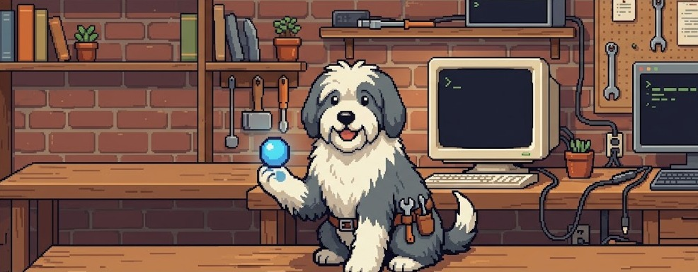

<p align="center">

</p>

<h1 align="center">robbie</h1>

<p align="center"><em>make's one great idea, written in words.</em></p>

<p align="center">
A small build tool and job runner. It reads a <code>Robfile</code>, shows in
colour what can be done in a repository, and makes what is out of date.
</p>

---

make has one great idea: a file saying what depends on what, and a program
that does only the work that is out of date. Around that idea it grew a
notation nobody reads without the manual open: `$@`, `$<`, `$^`, `$?`, `$$`,
tab-only recipes, `.PHONY`. robbie keeps the idea and spells it out:

| make                     | robbie                          |
|--------------------------|---------------------------------|
| `$@`, `$<`, `$^`, `$?`   | `{target}`, `{input}`, `{inputs}`, `{newer}` |
| `.PHONY: test`           | `task test:`                    |
| `%.o: %.c`               | `*.o: *.c`                      |
| `$(SRC:.c=.o)`           | `{*.o for *.c in SRC}`          |
| a shell per recipe line  | one script per recipe, for `sh -e` |
| tabs, and only tabs      | any indentation                 |

And it is the front door to a repository. Type `robbie` in a directory and
you see everything you can do there, what each task is for, and which files
are out of date:

```
 robbie  ~/r/robbie/Robfile

 tasks
   test           Run the tests, then check the man pages.  ← build/robbie
   install        Install into /home/luis/.local.           ← build/robbie
   uninstall      Remove what install put there.
   clean          Remove everything the build made.

 files
   build/robbie   The program itself.                       ← src/*.raz
 ● robbie.tar.gz  A release tarball.                        ← build/robbie doc/…

 variables
   raz = raz -Werror                     prefix = /home/luis/.local
   pages = doc/robbie.1 doc/robfile.5
```

`●` marks a file that is out of date: here the tarball, which has never
been made.

## The thirty-second tour

This is robbie's own `Robfile`:

```
# Robfile for robbie: build it, test it, install it.

raz    = raz -Werror
prefix = /home/luis/.local
pages  = doc/robbie.1 doc/robfile.5

# The program itself.
build/robbie: src/*.raz
    mkdir -p build
    {raz} -o {target} src/Robbie.raz

# A release tarball.
robbie.tar.gz: build/robbie {pages} README.md
    tar czf {target} {inputs}

# Run the tests, then check the man pages.
task test: build/robbie
    for t in test/*.sh; do
        sh "$t" | diff -u "${t%.sh}.out" - || exit 1
    done
    # groff exits 0 even when it warns, so any output is a failure
    out=$(groff -mdoc -ww -z {pages} 2>&1)
    test -z "$out" || { echo "$out"; exit 1; }

# Install into {prefix}.
task install: build/robbie
    install -Dm755 build/robbie "$DESTDIR{prefix}/bin/robbie"
    install -Dm644 doc/robbie.1 "$DESTDIR{prefix}/share/man/man1/robbie.1"
    install -Dm644 doc/robfile.5 "$DESTDIR{prefix}/share/man/man5/robfile.5"

# Remove what install put there.
task uninstall:
    rm -f "$DESTDIR{prefix}/bin/robbie" \
          "$DESTDIR{prefix}/share/man/man1/robbie.1" \
          "$DESTDIR{prefix}/share/man/man5/robfile.5"

# Remove everything the build made.
task clean:
    rm -rf build robbie.tar.gz
```

Read it top to bottom and you have the whole format:

- **A comment just above a rule is its description**, shown in the listing.
- **A comment may end a variable's line** (`inc = -I src   # note`): a `#` at the start of the value or after a blank ends it.
- **`name = value` is a variable**, and `{name}` fills it in anywhere: in
  a recipe, an input, a description, another variable.
- **`target: inputs` is a rule.** Its target is made again when it is
  missing or older than one of its inputs. `src/*.raz` is a glob.
- **`task name:` is a task**: a name for something to do rather than a file
  to make, so it always runs.
- **The indented lines are the recipe**, one script handed to `sh -e`: a
  loop can span lines, `cd` carries on, and the shell's own `$t` and
  `${t%.sh}` pass through untouched. Only a name in braces is robbie's.

Then:

```sh
robbie test                          # make build/robbie if needed, then test it
robbie -j4 robbie.tar.gz             # up to four recipes at once
robbie -n install                    # show what would run, run nothing
robbie install prefix=/usr DESTDIR=pkg
robbie -i                            # pick a task from the list, and run it
robbie -w test                       # test again whenever a source file changes
```

## What else it does

- **Patterns.** `*.o: *.c config.h` makes any `.o` from its `.c`; `{stem}`
  is what the `*` stood for.
- **Comprehensions.** `{*.o for *.c}` is an object for each C file on
  disk, and `{*.o for *.c in sources}` one for each word of `{sources}`, so
  a program can need files that don't exist yet.
- **Includes.** `include common.rob` reads another robfile in place.
- **Mistakes caught early.** Every recipe is checked before anything runs,
  and a typo is met with a suggestion:
  `robbie: Robfile:12: unknown placeholder {tagret}; did you mean {target}?`
- **Loops reported whole**, a link to a line, each with its place.
- **Half-made files removed.** A recipe that fails, or is interrupted,
  takes the target it had begun to write with it, so the next run doesn't
  mistake it for finished.
- **Parallel builds** with `-j`, and `-k` to make all that doesn't depend
  on what failed.
- **An interactive mode**, `robbie -i`: the listing on the terminal's
  alternate screen, filtered as you type, a target made on Enter, and its
  summary shown when you come back.
- **A watch mode**, `robbie -w test`: makes the targets again whenever a
  file they need, or the robfile, changes, until Ctrl-C. A task watches
  the files it names after its colon.
- **Plain text through a pipe.** Colour is only for a terminal, and never
  with `NO_COLOR`, so scripts and tests see the same words.

## Build and install

robbie is written in [raz](https://raz.lucela.org), a small
systems language, and builds with raz 0.18.0 and the C library (for
`glob(3)` alone). robbie builds itself, but a Makefile is kept so it can be
built without it:

```sh
make && make test
make install                         # PREFIX=$(HOME)/.local; DESTDIR honoured
```

Once it is built, `build/robbie test` and `build/robbie install` do the
same.

## Documentation

- [`robbie(1)`](doc/robbie.1): the command, its flags, the listing, the
  interactive keys and the exit statuses: `man robbie`.
- [`robfile(5)`](doc/robfile.5): the file, every feature, and a table for
  translating a Makefile: `man 5 robfile`.
- [`PLAN.md`](PLAN.md): the design, a module at a time, and the roadmap,
  which is for reading Makefiles as they are.
- The source, in [`src/`](src/), is written to be read top to bottom: each
  module opens with what it does and why, and every procedure says what it
  takes and gives.

## The name

From the Polish *robić*, "to do, to make": you tell robbie what to make,
and it makes it.

The mascot, also Robbie, is a Polish lowland sheepdog (*polski owczarek
nizinny*): a herder by trade, which suits a program that rounds up what is
out of date.
